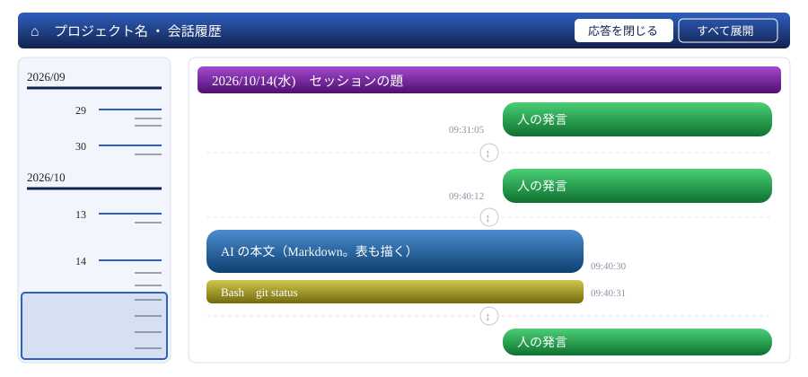

# 会話履歴ビューア 計画（JSONL から公開用の HTML を作る）

自分のプロジェクトの `etc/history/jsonl/` に溜まる会話ログを読み、伏せ字を掛けた静的なページを同じプロジェクトの中に作る。外部のサイトでそのまま公開できる形にする。

> 📅 作成: 2026-10-14 / 更新: 2026-10-18

[^^](../../README.md)

## 目次

1. [背景と目的](#1-背景と目的)
2. [入力と、載せるもの](#2-入力と載せるもの)
3. [伏せ字](#3-伏せ字)
4. [出力とビューア](#4-出力とビューア)
5. [決めること](#5-決めること)
6. [進め方とテスト](#6-進め方とテスト)

## 1. 背景と目的

会話ログ（JSONL）は、共通ルール「セッションログの自動保存」により、各プロジェクトの `etc/history/jsonl/` にコピーされる。<strong>そのままでは公開できない。</strong>ユーザーのパス、メールアドレス、ルールの全文、ほかのプロジェクトの発言が混ざっている。

これを、伏せ字を掛けた静的なページにする共有コマンド `history2html` を足す（決めたこと 12-A）。

- **使い方**: 各プロジェクトのルートで実行する。**自分のプロジェクトの履歴を読み、自分のプロジェクトの中に書く**。ほかのプロジェクトの履歴は読まない
- **見た目**: Claude Code のセッション履歴や LINE のトーク画面のような、吹き出しの並び
- **入力**: Claude Code の JSONL だけ。LINE などは見た目の手本で、読み込む対象ではない
- **出し先**: 同じプロジェクトの `notes/91_history/`（決めたこと 17）。公開してよい形で出し、そのプロジェクトの GitHub Pages 等で公開できる。CDN の JS を読んでよい
- **量**: 長い履歴でも開くのが重くならないように、日ごとのデータを分けて置き、見えるところだけを描く

| もの | 置き場 | Git |
|---|---|---|
| 本体 | `src/history2html/` | 管理 |
| ビューア（HTML ・ CSS ・ JS） | `src/history2html/viewer/` | 管理。書き出すときに、CSS と JS を `index.html` の中へ入れる |
| 伏せ字 ・ 伏せ漏れ検査 | `src/lib/` | 管理。check-public から切り出して共有する（第 3 章） |
| 入口 | `bin/history2html` ・ `bin/history2html.cmd` | 管理 |
| テスト | `tools/40_test/run-history2html-tests.ts` | 管理 |
| ビューアのテスト（ブラウザ） | `tools/40_test/run-history2html-viewer-tests.ts` ・ `tests/history2html-viewer/` | 管理 |

- **本体は TypeScript**。bun を優先し、無ければ node で動かす（ほかの道具と同じ入口）。テストも両方で回す
- **ビューアは JavaScript**（決めたこと 19-A）。型は JSDoc で付け、`tsc --checkJs` で検査する。書き出すときは写すだけで、ビルドの手順を持たない

## 2. 入力と、載せるもの

```text
history2html [--path <プロジェクト>] [--out <フォルダ>] [--word-list <パス>] [--title <題>]
```

- `--path`: プロジェクトのフォルダ。省くとカレント（check-public と同じ）。**読むのは `<プロジェクト>/etc/history/jsonl/`**
- `--out`: 出し先。**省くと `<プロジェクト>/notes/91_history/`**（決めたこと 17）。公開の前に試すときは `tmp/` の下を渡す
- `--word-list`: 伏せる語のリスト（第 3 章、決めること 16）
- `--title`: ページの題。省くとプロジェクトのフォルダ名
- 標準出力には件数だけを出す（日数 ・ 発言数 ・ 伏せた数を種類ごと）。**本文は出さない**
- 終了コード: 0 成功 ／ 1 伏せ漏れがあり、書き出さなかった ／ 2 引数の誤り

### JSONL の形（実測）

2026-10-14 に、このプロジェクトの会話ログ（`~/.claude` 側、115 ファイル、76,482 行）の形を数えた。本文は見ていない。`etc/history/jsonl/` は Git の管理外なので、数も見ていない（`~/.claude` 側より多いかどうかは未確認）。

- **直下の 3 ファイルがセッションの本体**。残りの 112 ファイルは `<セッション>/subagents/` の下のサブエージェントの記録
- **1 ファイルが 1 セッション**。sessionId が 2 つ以上あるファイルは 0。`uuid` の重複も 0
- **セッションの時間は重なる**。3 セッションのうち、時間が重なる組が 2、人の発言が互い違いに入る組が 1
- **記録の種類は 20 を超える**。会話の本体は `user` と `assistant` だけで、ほかは状態の控え（`file-history-*` ・ `bridge-session` ・ `cost-state` ・ `queue-operation` 等）
- **`<system-reminder>` ・ フックの追加文脈 ・ ルールの全文は、`attachment` という別の記録に入る**。ユーザーのメールアドレスもここに入る
- 人の発言は `origin.kind = "human"`。**古い記録には `origin` が無い**ので、本文の形でも見分ける
- 待受け ・ 背面コマンドの完了通知は `user` の記録で、本文が `<task-notification>` で始まる（570 件）。**ほかのプロジェクトの発言が入る**
- サブエージェントの記録は `isSidechain` が付く。`subagents/` の下に別のファイルもある
- セッションの題は `custom-title` の記録にある

### 拾うものを名指しする

<strong>載せる記録を名指しし、それ以外はすべて捨てる。</strong>捨てるものを並べる形にすると、Claude Code の更新で新しい種類が増えたとき、既定で載ってしまう。

| 記録 | 扱い |
|---|---|
| 人の発言（`user`。本文が文字列 ・ text で、下の除外に当たらないもの） | 載せる。右の吹き出し |
| AI の本文（`assistant` の `text`） | 載せる。左の吹き出し |
| ツールの呼び出し（`tool_use`）・ 結果（`tool_result`）・ 思考（`thinking`） | ツールは名前と 1 行の要約だけを載せる。結果の中身と思考は載せない（決めたこと 14-A） |
| セッションの題（`custom-title`） | セッションの区切りに出す |
| compact の区切り（`system/compact_boundary`） | 区切り線だけを出す。要約の本文（`isCompactSummary`）は載せない |
| 画像（`image`） | 載せない。「画像」とだけ出す |
| `attachment` ・ `isMeta` ・ `isSidechain` ・ `<task-notification>` ・ ローカルコマンド（`<command-name>` 等） | 載せない |
| 上のどれでもないもの | 載せない |

**日は JST で分ける**。`timestamp` は UTC なので、日をまたぐセッションは 2 日に分かれる。

## 3. 伏せ字

<strong>2 段で守る。</strong>拾った本文を置き換え、書き出す前に出力の全体をもう一度検査する。**検査で 1 件でも残れば、何も書かずに終了コード 1**。どこに何が残ったかは、ファイル名と種類だけを出す。

### 置き換えるもの

| もの | 見つけ方 | 置き換え |
|---|---|---|
| 自分のユーザープロファイルのパス | `C:\Users\<名前>`。区切りは `\` ・ `\\` ・ `/` のどれでも。`/c/Users/` も | `~` |
| ほかの `C:\Users\` 配下 | 同上 | `C:\Users\<username>` |
| git の author | `git config user.name` ・ `user.email` | `〈個人名〉` ・ `〈メールアドレス〉` |
| ユーザー名 ・ マシン名 | 環境から取る | `<username>` ・ `<hostname>` |
| メールアドレス | 一般的な形。`noreply@` ・ `example.com` は除く（check-public と同じ） | `〈メールアドレス〉` |
| 伏せる語のリスト | 単純一致。大小を区別しない | `〈伏せ字〉` |
| セッションの URL | `claude.ai/code/session_…` 等 | URL を消す |
| 認証情報の形 | よく知られた鍵の接頭辞、`password=` 等に値が続くもの | `〈認証情報〉` |
| 内部のホスト名 ・ IP アドレス | `*.local` ・ `*.internal`、プライベートの範囲（10/8 ・ 172.16/12 ・ 192.168/16） | `<hostname>` ・ `<IPアドレス>` |

- <strong>人の名前は、正規表現では見つけられない。</strong>伏せる語のリストに頼る。置き場は決めること 16
- **リストが無ければ止める**。check-public はその項目だけを飛ばして続けるが、こちらは公開する物を作るので、黙って通さない
- 見つけ方は check-public と同じものを使う。**`src/lib/` に切り出して両方から呼ぶ**。2 か所に書くと、片方だけが古くなる

#### 実装で変えた点

- <strong>ユーザー名は、パスの中だけで伏せる。</strong>Windows のユーザー名は `work` のような普通の語のことが多く、本文の全体から消すと会話が壊れる（`network` も消える）。名前が人を指すのはパスの中に置かれたとき。人の名前は git の author と伏せる語のリストで拾う
- <strong>実体パスは、区切りが重なった形（`C:\\Users\\…`）と Bash の形（`/c/Users/…`）も見る。</strong>会話ログにはどちらもよく出る。`src/lib/public-rules.ts` を直したので、check-public も同じものを拾うようになった
- <strong>`password=` 等の値が英数字だけのときは伏せない。</strong>コードの識別子と区別できないため（check-public と同じ判定）。記号を含む値と、よく知られた鍵の接頭辞は伏せる
- 2 段目の検査は、ファイルの字面ではなく中の文字列を行ごとに見る。JSON は 1 行につながり、行の境目が消えるため。check-public の「異体字」は秘密ではないので見ない

- **書き出したものは、そのプロジェクトの Git の管理下に入る**。`git add` したあとは check-public の検査の対象にも入るので、push の前にもう一度、同じ見つけ方で見られる

> [!IMPORTANT]
> <strong>機械の伏せ字は、公開してよいことの保証にならない。</strong>リストに無い名前、文脈で人が分かる話は残る。書き出したら、公開する前に人が目で読む。

## 4. 出力とビューア

```text
notes/91_history/                    --out を省いたときの出し先
  index.html                         ビューア（ヘッダー ・ 左の目盛り ・ 右の会話）。CSS と JS も中に入れる
  data/index.js                     目次。月 ・ 日 ・ 発言の一覧と、日ごとの量
  data/2026-10/2026-10-14.js         その日の人の発言と、応答のある位置
  data/2026-10/2026-10-14-res.js     その日の応答（AI の本文とツールの要約）。展開したときに読む
```

- **出し先が空でなく、前回この道具が作った印（`data/index.js`）も無ければ、書かない**。別のものを上書きしない
- 印があれば `data/` を作り直す。消えた日のファイルを残さない
- **中身が同じファイルは書かない**（2026-10-15、38-A）。会話が増えても、変わるのは新しい日 ・ 最終日 ・ 目次だけになり、更新日時も変わらない。画面に「書いた ・ 同じなので書かなかった ・ 消した」の数を出す
- **発言と応答を別のファイルに分ける**。既定では応答を出さないので、開いたときに読むのは人の発言だけで済む。量は 5.3 万字と 174 万字で、30 倍ほど違う（決めること 14 の実測）
- **`notes/` の下なので html2md の対象に入る**。`index.html` は html2md が既定で除外するが、`<meta name="md-skip">` も入れておく
- **CSS と JS は `index.html` の中へ入れる**（実装で変えた点）。共通ルール「CSS と JS の持ち方は docs/ かどうかで決める」で、`docs/` 以外は単独の HTML にするため。元は `src/history2html/viewer/` に分けて置き、書き出すときに入れる



既定では人の発言だけを出し、応答の位置には薄い記号（↕）を置く。記号をクリックすると、その応答だけを展開する。左の目盛りは右の会話の全体の高さに比例して線を引くので、つまみの位置とスクロールの位置が一致する。

### 左: 目盛り

- 縦の帯 1 本に、全期間を描く。**位置は右の会話の高さに比例させる**。だから、つまみを動かした量と右が動く量が一致する
- **月は長い横線**（ラベル `2026/10`）、**日は中くらいの線を右寄せ**（ラベル `14`）、**発言は短い線を右寄せ**。短い線の単位は決めること 15
- 線が詰まったところでは、ラベルを間引く。線は残す
- **つまみ**: いま見えている範囲を枠で示す。上下にドラッグすると右が動く。右をスクロールすると、つまみが追う
- 線や帯をクリックすると、その位置へ飛ぶ
- **線にマウスを乗せて 0.5 秒ほど置くと、日時を出す**。すぐには出さない（目盛りの上をなぞっただけで次々に出ないように）。つまみをドラッグしている間は出さない
    - **一度出たあとは、上下に動かすだけで即座に追従する**。待ち時間を挟まず、ポインタにいちばん近い線の日時に切り替え、枠もポインタの高さに付いて動く
    - **左ペインの外に出たら消し、最初からにする**。また入ったときは、0.5 秒の待ちからやり直す
- 出す中身
    - 月の線: `2026/10`
    - 日の線: `2026/10/14(水)`
    - 発言の線: `2026/10/14(水) 09:31:05`。その下に発言の先頭（30 字ほど）
- 線は細いので、乗せたと見なす範囲は線の上下数 px まで広げる
- ブラウザの `title` は出るまでの時間を決められないので使わない。自前の小さな枠で出す

### 上: 固定のヘッダー

- スクロールしても動かない。左に ⌂（README へ戻る）と題、右に応答の出し方の切り替え
- **切り替えは「応答を閉じる」と「すべて展開」の 2 つ。既定は「応答を閉じる」**（初めの名前は「応答なし」）。「すべて展開」にすると、決めたこと 14-A の形（AI の本文とツールの要約）で、すべての応答を出す
- 切り替えると、1 つずつ展開 ・ 畳んだ状態は捨てて、全部がそちらにそろう
- **選んだ状態は、タブを閉じるまで覚える**（2026-10-15 に変更。33-A。キーは「実装のあとに足したこと」の表）。初めは覚えず、開くたびに「応答なし」から始めていた

### 右: 会話

- **既定では人の発言だけを出す**。応答のある位置（発言と発言の間）には、展開を表す記号（↕）を薄く置く
- **記号をクリックすると、その応答だけを展開する**。展開した応答の上下にも同じ記号を置き、どちらをクリックしても畳む
- 展開 ・ 畳むときは、クリックした記号が画面の同じ位置に残るように直す。目盛りも引き直す
- **日付は、変わるまで 1 つだけ出す**。日の見出し（`2026/10/14(水)`。曜日のかっこは半角）が上に貼り付く（`position: sticky`）。compact の区切りに線を出す
- **セッションをまたいで、依頼を人の発言の時刻順に並べる**（決めたこと 20-A）。セッションは色の帯で見分け、変わったところで題を出す
- **時刻は秒まで（JST の `hh:mm:ss`）を、小さく薄い灰色の字で**吹き出しの横に出す。ツールの要約の行にも出す
- 人の発言は右、AI は左の吹き出し。ツールの要約は AI の側に、小さな 1 行で出す。失敗したものには ❌
- **Markdown は marked で描く**。GFM の表 ・ 取り消し線 ・ タスクリストに対応する
- **本文中の生の HTML はタグとして効かせず、文字のまま出す**。会話には HTML の話が多く、効かせると崩れる。描いた結果は DOMPurify にも通す（公開するページに、会話の中身から script を入れない）
- コードの色付けはしない。要るときに足す
- 色は共通ルール「HTMLデザインルール」に従う（背景は淡く、タイトルバーは紺）

### 長い履歴を軽く開く

- **開いたときは、いちばん古い履歴を出す**（2026-10-15 に変更。初めは最新を出していた）。並びは古い順（上が古く、下が新しい）。最新へはヘッダーの「最新へ」ですぐ行けるので、上から読み始める方が自然
- **最初は目次（`data/index.js`）だけを読む**。日ごとに、目次の量（発言数 ・ 文字数）から高さを見積もった空の箱を並べる。これで目盛りが描ける
- **画面と前後 1 画面ぶりに入った日だけを読み、描く**（IntersectionObserver）
- **応答のファイル（`-res.js`）は、展開したときに初めて読む**。「すべて展開」のときも、画面の近くの日の分だけを読む
- **`content-visibility` は使わない**（実装で変えた点）。実データ（44 日 ・ 依頼 1,109）で、開くのに 0.5〜0.9 秒、すべて展開に 0.9〜1.2 秒で足りた。付けると、画面の外の要素の位置（目盛りの線）が取りにくくなる
- 上の日が描かれて高さが変わっても、見ている位置がずれないように直す。目盛りも引き直す
- 目盛りから遠くへ飛ぶときは、飛び先の日を先に読み、描いてから位置を合わせる
- 1 日分が大きいとき（数百の発言）は、少しずつ分けて描き、画面を止めない

### CDN

- marked と DOMPurify を、cdnjs か jsDelivr から読む。**版を固定して書き、`integrity`（SRI）を付ける**。版は実装のときに決める
- CDN が読めないときは、本文を文字のまま出す。白い画面にしない

## 5. 決めること

<strong>決めたこと（2026-10-14、利用者の判断）。</strong>12-A ・ 13-A ・ 14-A ・ 15-A ・ 16-A。14-A は、まずこれで進めて様子を見る。あわせて、**既定では応答を出さず、ヘッダーで「すべて展開」に切り替えられる**形にする（第 4 章）。17 は `notes/91_history/`（案の外から選んだ）。19-A ・ 20-A。**この計画を承認（2026-10-14）**。

### 実装のあとに足したこと（2026-10-14、利用者の判断）

- **`--in`**: 会話ログのフォルダを指定できる。相対はカレントから
- **表題**: プロジェクトのフォルダ名と 1 行の概要（31-A）。概要は `--lead` で渡す。省くと、そのプロジェクトの README.html のタイトルバーの `.lead` を使う。どちらも伏せ字を掛ける
- **データの名前**: 人の発言は `<日>-req.js`、応答は `<日>-res.js`（依頼と応答の対）
- **検索**（32-A）: 人の発言と応答の両方を探す。3 文字以上は入力のたびに、1〜2 文字は Enter を押したときに探し（36-A）、最初に当たったところへ飛ぶ。大小を問わない。当たった語に印を付け、応答で当たったらその応答を展開する。「一番上へ ・ 上へ ・ 下へ ・ 一番下へ」と、`3/27` のような件数を出す。**検索欄にカーソルが来たら、裏で全部の日（応答も）を読み始める**
- **先頭へ ・ 最新へ**: ヘッダーのボタンで、いちばん古い会話といちばん新しい会話へ飛ぶ。アイコンは「上の横線 ＋ 上向きの矢印」と「下向きの矢印 ＋ 下の横線」
- **切り替えの名前**: 「応答なし」は「応答を閉じる」にした
- **展開の記号**: 閉じているときは「展開する」（上下の外側へ向いた矢印）、開いているときは「畳む」（上下の内側へ向いた矢印）
- **目盛りの月のラベル**: その月の初日まで書く（`2026/10/4`。37-B）。初日は月の線と重なり、日の数字が出ていなかったため。日 ・ 月のラベルは、間隔が狭いと書かない（日は 14 px、月は 16 px 未満）。線はすべて引く
- **「すべて展開」のあとのドラッグ**: つまみがポインタから離れて上端へ飛ぶ不具合を直した。ドラッグ中は、つまみの位置の割合で右の位置を決め、見ている位置を保つ処理を止める。目次に日ごとの応答の量（`rn` ・ `rc`）を入れ、すべて展開のときの高さの見積もりに使う
- **目盛りの左の余白**: 左に少し余白を取る。そこはクリックしても何も起きない（飛ばない ・ ドラッグも始まらない）
- **覚える状態**（33-A）: ヘッダーの「応答なし ／ すべて展開」だけを sessionStorage に覚える。1 つずつの展開は覚えない
- **警告**（34-A）: 伏せる語のリストが空のとき、git の author が取れなかったときに ⚠️ を出す。書き出しは止めない。あわせて、**伏せた後の語と件数を ✅ 付きで並べる**（元の値は出さない）

#### ブラウザに残すもの（共通ルール「Web で設定を残すときは、保存先とキーを聞いてから決める」）

<strong>決めたこと（2026-10-18、利用者の判断）。40-A。</strong>キーは全プロジェクトで 1 つを共有する（題ごとに分けない）。`file://` では全部のページが同じ置き場になるため、同じタブで開いた別プロジェクトのページにも同じモードが効く。

| キー | 保存先 | 値 | 消えるとき |
|---|---|---|---|
| `history2html.mode` | sessionStorage | `none` ・ `all` | タブを閉じたとき |

#### 12. 道具の名前

- **12-A（推奨）**: `history2html`。推す理由: `html2md` と同じ「入力 2 出力」の形で、何を何にするかが名前で分かる
- **12-B**: `publish-history`。公開用と分かるが、サイトへ上げるところまでするように読める
- **12-C**: `chat-viewer`。見る道具に読め、伏せ字を掛けて書き出す役目が名前に出ない

#### 13. 日ごとのデータの形

- **13-A（推奨）**: `.js`。`<script>` を足して読み、中で決まった関数に渡す。推す理由: **出したものを手元で `file://` のまま開いて確かめられる**。公開の前に人が目で読む手順（第 3 章）が、サーバ無しで済む
- **13-B**: `.json`。`fetch` で読む。データとして素直だが、手元で見るにはサーバが要る（ブラウザは `file://` の `fetch` を止める）

#### 14. ツールと思考をどこまで載せるか

- **14-A（推奨）**: ツールは名前と 1 行の要約（下の表）だけ。結果の中身と思考は載せない。失敗した呼び出しには ❌ の印だけを付ける。推す理由: 何をしたかの流れは追え、**ファイルの中身（伏せ字で拾えない秘密が混ざる所）は出ない**
- **14-B**: 14-A に加えて、ツールの結果を先頭 20 行まで、畳んで載せる。作業の中身まで読めるが、伏せ漏れの余地が広がる
- **14-C**: 発言の本文だけ。ツールも思考も載せない。いちばん安全だが、AI が何をしたかが見えない

このプロジェクトの会話ログで量を数えた（2026-10-14、サブエージェントを除く。本文は見ていない）。

| もの | 件 | 字 | A | B | C |
|---|---|---|---|---|---|
| 人の発言 | 1,113 | 5.3 万 | 載せる | 載せる | 載せる |
| AI の本文 | 4,358 | 110 万 | 載せる | 載せる | 載せる |
| ツールの要約（1 行目、200 字まで） | 9,494 | 64 万 | 載せる | 載せる | — |
| ツールの結果（先頭 20 行まで） | 9,494 | 343 万 | — | 載せる | — |
| 思考（中身が残っているもの） | 138 | 1.5 万 | — | — | — |
| **載せる量の計** |  |  | 179 万 | 523 万 | 115 万 |

- **1 つの依頼につき、ツールは平均で約 8.5 回**。A では、吹き出しの間に小さな行がそれだけ挟まる
- **B は A の約 2.9 倍**。結果の全体は 587 万字あり、20 行を超える結果は 1,433 件
- **思考は、ほとんどログに残っていない**（3,973 件のうち中身があるのは 138 件）。載せるかどうかで差がほぼ出ない
- 失敗した呼び出しは 339 件

| ツール | A の要約に出すもの | 出さないもの |
|---|---|---|
| Bash ・ PowerShell | コマンドの 1 行目（200 字まで）。2 行目以降があれば「…」 | 2 行目以降（939 件。ヒアドキュメントの中身等） |
| Read | パスと行の範囲 | 読んだ中身 |
| Edit ・ Write | パス | 書いた中身 |
| Grep ・ Glob | 検索語とパス | 当たった行 |
| WebFetch ・ WebSearch | URL ・ 検索語 | 取ってきた中身 |
| Agent | 説明（`description`） | 頼んだ文（`prompt`） |
| そのほか | ツール名だけ | 入力 |

- **A でも残るもの**: コマンドの 1 行目に書いた値（鍵を付けた `curl` 等）。認証情報の形で拾う
- **B で増えるもの**: 読んだファイルの中身（Git の管理外のものを含む）、`git log` の出力、待受けで受けたほかのプロジェクトの発言。伏せる語のリストに無い名前は素通りする
- **C で失うもの**: AI が「直しました」と書いたとき、どのファイルを触り、何を実行したかが見えない

#### 15. 左の短い横線の単位

- **15-A（推奨）**: 人の発言（依頼）ごと。推す理由: 依頼の単位で飛べる。LINE の吹き出し 1 つに近い
- **15-B**: セッションごと。線が少なく、発言の多い日でも潰れない

#### 16. 伏せる語のリストの置き場

- **16-A（推奨）**: check-public と同じ、プロジェクト直下の `_public-ng-words.txt`。`--word-list` で差し替えられる。推す理由: 公開前の検査と同じ語で伏せられ、リストを 2 つ持たない
- **16-B**: ホーム配下に 1 つ置き、全プロジェクトで使う。プロジェクトごとに書かずに済むが、check-public とリストが分かれる

#### 17. 出し先の既定（`notes/` の下の番号）

案は、共通ルール「番号付きフォルダ」の `notes/` の空き番号から 17-A `70_history`（推奨）・ 17-B `50_history` を出した。

**決めたこと（2026-10-14、利用者の判断）。**`notes/91_history/`。**本編のフェーズに属さない特殊なもの**で、毎回作るわけではなく、一部のプロジェクトだけで生成するため、90（常に参照するもの）の後ろに置く。

91 は、共通ルールの「10 刻み」から外れる。**ツールができてから、共通ルール「番号付きフォルダ」に書き足す**（[課題 i261014-01](../40_issues/issues.html)）。

<strong>決めたこと（2026-10-18、利用者の判断）。</strong>18-B。共通ルールに、**91〜99 をフェーズに属さない特殊なものの枠**として定め、`notes/` の行に `91_history` を足した。反映して、public ルームへ周知した。

#### 19. ビューアの書き方

ブラウザは `.ts` をそのまま動かせない。本体（TypeScript）とは別に決める。

- **19-A（推奨）**: JavaScript で書く。型は JSDoc で付け、`tsc --checkJs` で検査する。推す理由: 書き出すときに写すだけで済み、ビルドの手順が要らない。node で動かすときも同じ
- **19-B**: TypeScript で書き、JavaScript に変換して置く。変換に `bun build` が要り、node だけの環境では書き出しのたびに変換できない。変換済みを Git に入れると、元と変換後の 2 つを揃えて保つ手間が増える

#### 20. 時間が重なったセッションの並べ方

同じプロジェクトで複数のセッションを同時に動かすと、時刻が重なる（第 2 章の実測）。時間軸で並べる単位を決める。

- **20-A（推奨）**: 依頼の単位で、人の発言の時刻順に並べる。応答はその依頼の下にまとめる。推す理由: 既定の表示は人の発言だけなので、そのまま時間軸の順になる。展開しても、1 つの依頼への応答の途中に別のセッションの応答が割り込まない。代わりに、展開した応答の時刻が次の依頼より後になることがある
- **20-B**: 記録を 1 件ずつ、すべて時刻順に並べる。厳密な時間軸になるが、展開すると 2 つのセッションの応答が交互に入り、どの依頼への応答かを追いにくい

どちらでも、次の 2 つを足す。

- **セッションの見分け**: 吹き出しの端に、セッションごとの色の細い帯を付ける。前の発言とセッションが変わったところで、セッションの題を小さく出す
- **人の発言なしで始まる応答**: 待受けの通知などで、人の発言が無いまま AI が応答することがある。通知の中身は載せないので、その位置に薄い「通知」の印を置き、そこから別の依頼として扱う。何時間も後の応答が、前の依頼の下にまとめられないように

## 6. 進め方とテスト

1. 決めることの承認を得る（2026-10-14 済）
2. check-public の見つけ方（メールアドレス ・ パス ・ 認証情報 ・ 伏せる語 ・ author）を `src/lib/` に切り出す。check-public のテストが変わらず通ることを確かめる（2026-10-14 済）
3. テストを先に書く。落ちるのを見てから実装する（2026-10-14 済）
4. 実装する。読む → 拾う → 伏せる → 日ごとに分ける → 検査する → 書く（2026-10-14 済）
5. ビューアを作り、PlayWright 共有環境で動きを確かめる。check-contrast も通す（2026-10-14 済）
6. このプロジェクトの履歴を `--out` で `tmp/` の下に書き出し、件数と所要時間を報告する（本文は報告に出さない）（2026-10-14 済）
7. TOOLS-USAGE に使い方を書く。README の一覧に足す（2026-10-14 済）
8. 共通ルール「番号付きフォルダ」に `91_history` を書き足す案を出し、反映したら周知する（課題 i261014-01）

### 結果（2026-10-14）

| 確かめたこと | 結果 |
|---|---|
| check-public の切り出し（`src/lib/public-rules.ts`） | ✅ 22 件そのまま通った。実体パスの 2 つの形を足して ❌Red（2 件）→ ✅Green（25 件） |
| history2html（`run-history2html-tests.ts`） | ❌Red（44 件）→ ✅Green（73 件）。bun ・ node とも |
| ビューア（`run-history2html-viewer-tests.ts`。PlayWright 共有環境） | ✅ 10 件 × 3 ブラウザ（Chromium ・ Firefox ・ WebKit）= 30 件 |
| 型チェック（ビューアは `tsc --checkJs`） | ✅ 誤りなし |
| このプロジェクトの会話ログ（`tmp/` に書き出し） | ✅ 3 セッション ・ 44 日 ・ 依頼 1,109 ・ 人の発言なしの応答 638 ・ AI の本文 4,378 ・ ツール 9,574。伏せたパス 557。3.6 秒。伏せ漏れの検査を通った |
| そのページをブラウザで（3 ブラウザ） | ✅ 開く 0.5〜0.9 秒 ・ すべて展開 0.9〜1.2 秒 ・ いちばん古い日へ 0.6〜1.0 秒。JavaScript の誤り 0 |
| 書き出したものを check-public で | ⚠️ 1 件（異体字）。会話にキリル文字かハングルが入っていた。秘密ではない |

- 目盛りから日へ飛ぶと 14px ずれる不具合を、テストで見つけて直した。描いた日の最初の子の上の余白が箱の外へはみ出し、位置を保つ目印の箱が動いていた（`display: flow-root` で閉じ込めた）
- PlayWright 共有環境から `@playwright/test` を読めなかった。このリポジトリは `"type": "module"` で、テストが ESM として読まれ、共有環境が渡す `NODE_PATH` が効かない。テストを `.cts`（CommonJS）にして回した。<strong>決めたこと（2026-10-18、利用者の判断）。</strong>27-A。`.cts` は暫定で、共有環境の側で直してもらうため、`:PlayWright:` へ報告した（ai-chat-lite #1533）。返事が来たら、テストの拡張子を戻せるか確かめる
- ビューアのひな形（`src/history2html/viewer/index.html`）は資料ではないので、HTML の規則の検査（`check-html-rules.ts`）から `src/` を外した

### テスト

JSONL はテストの中で合成する。人を表す値は `user1`、アドレスは `example.com` にする（共通ルール「テストのルール」）。

- **拾う**: 人の発言と AI の本文だけが出る。`attachment` ・ `isMeta` ・ サイドチェーン ・ `<task-notification>` ・ 知らない種類の記録は出ない
- **伏せる**: 第 3 章の表の 1 行ごとに 1 件。パスは区切りの 3 通りを入れる
- **伏せ漏れ**: 置き換えをすり抜ける値を仕込むと、何も書かずに終了コード 1
- **リストが無い**: 止まる
- **日の分け方**: UTC 15:00 の発言が JST の翌日に入る
- **重なったセッション**: 2 つのセッションの発言が互い違いのとき、依頼が人の発言の時刻順に並び、応答はそれぞれの依頼の下に入る。通知で始まった応答は、前の依頼に混ざらず「通知」の印の下に入る
- **置き場の既定**: `--path` のプロジェクトの `etc/history/jsonl/` を読み、`notes/91_history/` に書く。`--path` を省くとカレント
- **分け方**: 人の発言と応答が別のファイルに入る。日の時刻が `hh:mm:ss`（JST）で入る
- **出し先**: 印の無い空でないフォルダには書かない。印があれば、消えた日のファイルが残らない
- **ビューア**（PlayWright）:
    - 開いたときに最新（いちばん下）が見え、応答は出ていない。応答のファイルを読んでいない
    - ↕ をクリックするとその応答だけが出て、もう一度で畳む。ヘッダーの「すべて展開」「応答なし」で全部がそろう
    - 日付の見出しが日ごとに 1 つだけ。時刻が `hh:mm:ss`
    - 目盛りの線をクリック ・ つまみをドラッグすると、その日へ動く
    - 目盛りの線に乗せると、すぐには出ず、0.5 秒ほどで日時が出る。出たあとに上下へ動かすと、待たずに別の線の日時へ切り替わる。左ペインの外へ出ると消え、戻ったときはまた 0.5 秒待つ
    - 表が `<table>` として描かれる。本文中の `<script>` が動かない

[^^](../../README.md)
